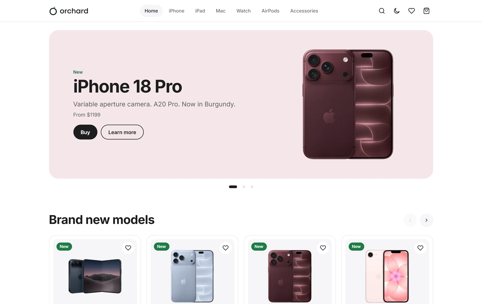
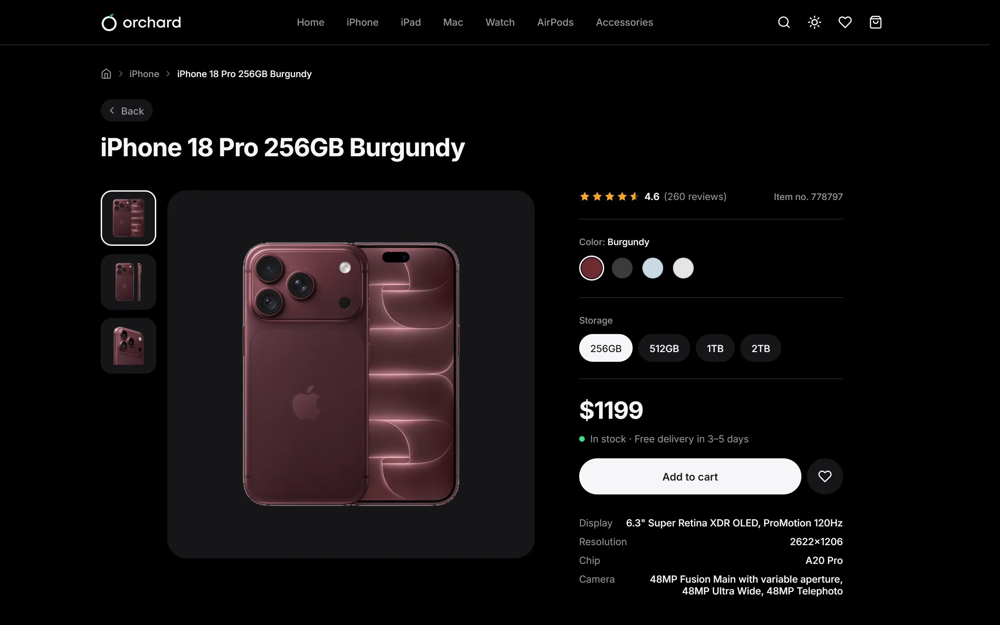
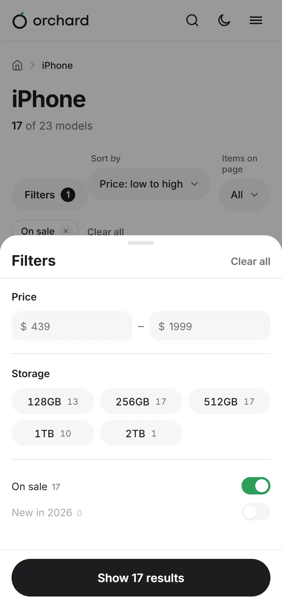
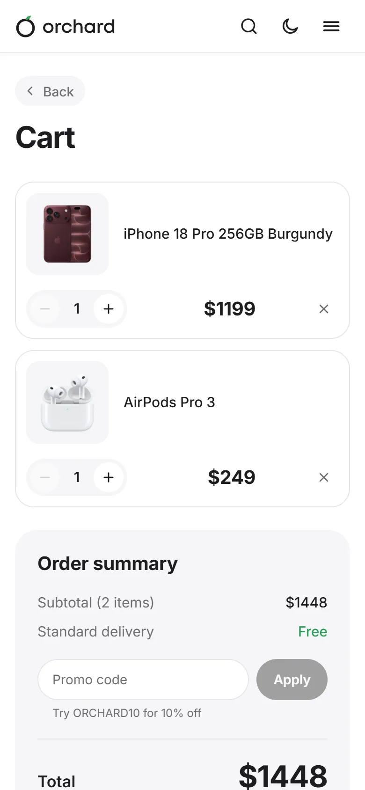
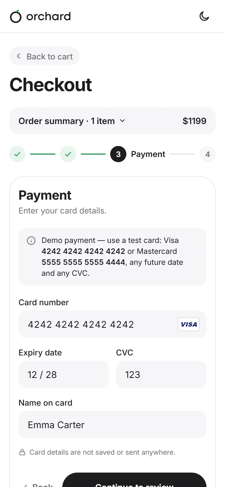

# Orchard — Apple devices store

An online store for iPhone, iPad, Mac, Apple Watch, AirPods and accessories, built with React and TypeScript.

This is a portfolio project. Orders and payments are a demo: nothing is charged or shipped.

**[Live demo](https://arkatovnikita.github.io/orchard-store/)**

[](https://github.com/arkatovnikita/orchard-store/actions/workflows/ci.yml)

<p>
  
  
</p>
<p>
  
  
  
</p>

## Features

- **Home page** — hero banner with autoplay, product sliders (new models, hot prices, recently viewed), shop by category, FAQ.
- **Catalog** — 6 categories, 98 models and 780 variants. Filters by price, storage or case size, sale and new items, with live result counts. Sorting and pagination. Filters are stored in the URL, so a filtered page can be shared or reloaded.
- **Search** — instant results in the header with highlighted matches and keyboard navigation, plus a full results page.
- **Product page** — photo gallery, color and storage variants, specs, reviews, sticky "Add to cart" bar on mobile.
- **Cart and favorites** — saved in the browser, quantity controls, promo codes.
- **Checkout** — 4 steps: contact, delivery, payment and review.
  - Field validation with focus on the first error, name and address formatting, email typo suggestions.
  - US phone mask, state picker, card number formatting with Visa / Mastercard detection and Luhn check.
  - Each step has its own URL, so the browser Back button works. Card details are never stored.
- **Polish** — light and dark theme, loading skeletons, images that fade in, keyboard and screen reader support.

## Technical decisions

- **No state libraries.** Cart, favorites and theme live in React Context and are saved to `localStorage` through a `useLocalStorage` hook. The app is small enough that Redux would only add code.
- **The URL is the state.** Catalog filters, sorting, page and the checkout step are read from search params. Links can be shared, and Back and Forward work as expected. If someone opens a later checkout step directly, they are sent to the first step that is not filled in yet.
- **Own form hook.** `useForm` keeps values, validators and formatters for each step, focuses the first invalid field on submit and saves contact and delivery data to `sessionStorage`. Payment data is kept only in memory.
- **Masked inputs that keep the caret.** Phone, card number and expiry are formatted while typing, and the caret stays in place when digits are added or removed in the middle.
- **A select for each device.** On a mouse device the select is a custom list with keyboard support and type-ahead. On touch screens it is the native select, which phones already handle well. The choice is made with `matchMedia('(hover: hover) and (pointer: fine)')`.

## Performance

Lighthouse, mobile, measured on the live site:

| Page    | Performance | Accessibility | Best Practices | SEO |
| ------- | ----------- | ------------- | -------------- | --- |
| Home    | 99          | 100           | 100            | 100 |
| Product | 98          | 100           | 100            | 100 |

- Pages are loaded lazily with `React.lazy`, so the main bundle is 71 KB gzipped.
- Product data is fetched once per visit and cached.
- The first banner image is preloaded with high priority.
- Skeletons keep the layout in place while data loads, so nothing jumps.

## Testing

119 unit tests with Vitest cover the logic where a mistake would cost the most:

- **Checkout** — every field validator, Luhn check, Visa / Mastercard detection, phone and card formatting, typing and deleting in the expiry field, email typo suggestions.
- **Catalog** — filters, the counts next to each filter option, sorting.
- **Search** — matching several words in any order.
- **Cart** — adding and removing items, quantities, totals and promo codes.

Tests live next to the code they check, for example `validators.ts` and `validators.test.ts`. Run them with `npm test`.

On every push, GitHub Actions installs the project and runs the linters, the tests and the build.

## Tech stack

- React 18 and TypeScript
- React Router 6
- SCSS modules
- Vite
- Vitest
- ESLint (Airbnb), Prettier and Stylelint

## Routes

| Path                                                     | Page             | Notes                                                                    |
| -------------------------------------------------------- | ---------------- | ------------------------------------------------------------------------ |
| `/`                                                      | Home             | Banner, product sliders, categories, FAQ                                 |
| `/iphone` `/ipad` `/mac` `/watch` `/airpods` `/accessories` | Catalog          | `sort`, `page`, `perPage`, `minPrice`, `maxPrice`, `storage` or `size`, `sale`, `new` |
| `/product/:productId`                                    | Product          | Color and storage switch the URL to another variant                      |
| `/search`                                                | Search results   | `query`                                                                  |
| `/favorites`                                             | Favorites        |                                                                          |
| `/cart`                                                  | Cart             | Promo codes                                                              |
| `/checkout`                                              | Checkout         | `step` for the current step, `order` for the confirmation                |
| any other                                                | Not found        |                                                                          |

## Getting started

Requires Node.js 18 or newer.

```bash
git clone https://github.com/arkatovnikita/orchard-store.git
cd orchard-store
npm install
npm start
```

| Command           | What it does                        |
| ----------------- | ----------------------------------- |
| `npm start`       | Starts the dev server               |
| `npm run build`   | Type-checks and builds the project  |
| `npm run preview` | Serves the build locally            |
| `npm test`        | Runs the tests                      |
| `npm run lint`    | Runs ESLint and Stylelint           |
| `npm run format`  | Formats the code with Prettier      |
| `npm run deploy`  | Publishes the build to GitHub Pages |

## Project structure

```
src/
├── index.tsx                 # routes and context providers
├── App.tsx                   # layout: header, page, footer
├── pages.ts                  # pages loaded lazily with React.lazy
├── modules/                  # one folder per page
│   ├── HomePage/             # banner slider, product sliders, categories, FAQ
│   ├── CatalogPage/          # filters, mobile filter sheet, sorting, pagination
│   │   └── utils/            # filter and sort logic
│   ├── ProductDetailsPage/   # gallery, color and storage options, specs, reviews
│   ├── SearchPage/           # full search results
│   ├── CartPage/             # cart items and order summary
│   ├── CheckoutPage/         # 4-step checkout
│   │   ├── components/       # steps, stepper, phone, card and expiry inputs
│   │   ├── hooks/            # useForm: values, validation, saving to sessionStorage
│   │   └── utils/            # validators, Luhn check, caret position, formatting
│   ├── FavoritesPage/
│   ├── NotFoundPage/
│   └── shared/               # code used by several pages
│       ├── api/              # data fetching with an in-memory cache
│       ├── components/       # header, search panel, product card, slider, select, skeleton
│       ├── context/          # cart, favorites, theme, notifications
│       ├── hooks/            # useLocalStorage, useDebounce, useMediaQuery, useInView
│       ├── constants/        # categories, navigation, promo codes
│       ├── types/            # Product, CartItem, Review
│       └── utils/            # product search, cart totals
├── styles/                   # colors for both themes, sizes, mixins
├── assets/                   # icons and images
└── test/                     # helpers shared by tests
public/
├── api/                      # catalog data: all products and one file per category
├── img/products/             # product photos in WebP
└── 404.html                  # sends links typed without # to the app
```

## Deployment

The site is hosted on GitHub Pages. `npm run deploy` builds the project and publishes the `dist` folder to the `gh-pages` branch.

GitHub Pages serves only static files, so the app uses `HashRouter`: everything after `#` is handled in the browser. If a link is typed without `#`, for example `/orchard-store/iphone`, `public/404.html` redirects it to `/orchard-store/#/iphone`.

## Data

The catalog was prepared from Apple's public product information and photos. Prices and reviews are illustrative.

## Contact

Mykyta Arkatov — [GitHub](https://github.com/arkatovnikita) · [Telegram](https://t.me/arkatov_nikita)

## License

MIT. Orchard is not affiliated with Apple Inc. Product names and images belong to Apple Inc.
